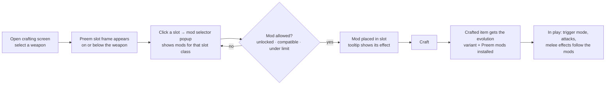

# Preem Weaponsmith — Spec

> **One line:** a Cyberpunk 2077 PC mod that lets players craft weapons with their own choice of Preem mods (barrels, triggers, magazines, blades, handles) that change how a weapon fires and behaves, right in the vanilla crafting screen.
> **Sources merged:** `docs/MODDING-WORKFLOW.md` (2026-10-25), release history v1.0.0–v2.2.5, Nexus description (`docs/nexus-description.txt`)
> **Terms:** `GLOSSARY.md` · **Hard-to-reverse decisions:** `docs/adr/`

## Status
*Updated at each phase end.*

| § | Feature | Status | Phase |
|---|---|---|---|
| 2 | Crafting with Preem mods (2.2.5 behaviour) | On 2.5: compiles, loads, all TweakDB records verified (self-check 4136/0), rule tests pass; one fix (`CraftItem` falls back when a weapon has no evolution variant). Crafted in a loaded save through the debug commands: 3 end-to-end cases pass (Smart swap, melee mods, Burst trigger replacing full-auto); look and feel in play is the gate's. Evolution variants now carry their new evolution's tags, price entry, preview effect and secondary trigger (Phase 2 gate feedback; the self-check covers them) | 1, 2 |
| 4 | Preem mod catalogue and effects | Built (2.2.5); every fixed record (38 mods and their stats, slots, blueprint elements) is TweakXL YAML in `tweaks/`, proven identical to the script version by the record dump (142 records, 3838 flats); records made per weapon stay in `ScriptableTweak`. All 38 offered mods' records resolve on 2.5 | 1, 2 |
| 5 | Progression: unlock mode and mod limit | Built (2.2.5); RedTest covers slot rules, compatibility and unlock tiers on 2.5 | 1 |
| 6 | Fire-mode sounds | Built with the Codeware patch (ADR 0001): `PreemCrafting.Audio` fills 222 empty fields at load (the event map's 191 on 70 sound sets plus 31 gap fills on 16 sets, 8 of them new; 78 sets in all; 199 base + 23 ep1), no `.archive` in the release. Every auto-fire and burst fill (105, plain and suppressed) played on the player's weapon in a loaded save; the charge fills (start, ready, perk) are unit-tested, set at load and confirmed by ear at the Phase 3 gate. Ashura Full-Auto plays nothing in the sweep (1-round magazine, expected) | 3 |
| 7 | Settings | Per-save store `PreemSettings` built; values survive save and reload. Mod Settings optional: seeds new saves when installed, built-ins otherwise. Settings panel built (SETTINGS button on the Preem slot frame, popup; changes apply at once), run in a save | 1 |
| 8 | Dev surface: self-check, RedTest, boot check | Built: compile check (+ exec/module warning), boot check (dependency check, screenshot on failure, `-Run`/`-HoldSec`, `-Without`, `-WithEnhancedCraft`), self-check, 113 RedTest checks, vanilla-marker comparison, sound listener and sound sweep (dev only, need Audioware), crafting, settings and crafting-screen UI debug commands, `-LoadSave` (loads the newest save) and `-Screenshot`, control-character pre-commit hook, `tools/pack-release.ps1` (scripts + YAML), record dump `tools/tweak-dump.ps1` with a committed baseline | 0, 1, 2, 3 |
| — | Release 2.3.0 and upkeep | 2.3.0 zip built and proven (zip-only boot, 199 + 23 load lines, no log errors), tagged `v2.3.0` and pushed; Nexus upload at the Phase 4 gate. CHANGELOG covers every release; Nexus page text in `docs/nexus-description.txt`; patch-upgrade runbook `docs/PATCH-UPGRADE.md` walked once | 4 |

## 1. Overview
- **Problem / pitch:** vanilla weapons come with fixed fire modes and evolutions (Power/Tech/Smart), and weapon mods are flat stat sticks. Preem Weaponsmith lets the player pick mods while crafting that change the weapon itself: switch evolution with a barrel, change the trigger mode, add elemental magazines, give melee weapons elemental blades or movement handles.
- **Users:** PC players on Nexus who craft weapons; mod users who also run EnhancedCraft.
- **Pillars:**
  1. **Feels native.** UI lives inside the vanilla crafting screen and matches its style.
  2. **Mods change behaviour, not just numbers.** A Tech barrel makes a Tech weapon; a burst trigger fires bursts.
  3. **Plays well with others.** Wrap game methods, never replace them; keep EnhancedCraft compatible.
  4. **Survives patches.** Hooks are few and listed, records are checked automatically, and the upgrade path is written down.
- **Non-goals:** console or mod.io builds (scripts aren't allowed there); new weapons, meshes or models; a CET or RED4ext rewrite; keeping saves from before patch 2.5 working, or making the 2.5 version backward compatible with earlier mod versions (decided 2026-10-25). Players are told a new save may be needed.

## 2. Core loop

Ranged weapons have Barrel, Trigger and Magazine slot classes (two slots each). Melee weapons have Blade and Handle. Sight is defined but not exposed.

### 2.1 Upgrade screen (Phase 5, decided 2026-10-26)
The same Preem slot frame appears on the crafting screen's Upgrade tab, for weapons the player already owns, iconics included. Rules:
- **No evolution barrels** on an owned weapon: an existing item keeps its record (and `ItemID`, quest flags, iconic identity, equipped state), so evolution changes stay a crafting-only choice.
- **Installed Preem mods** show in their slots and count toward the mod limit; the player can remove or replace them freely. Mods cost nothing, so nothing is refunded: a removed mod item is deleted, not given back.
- **Rarity:** with the Weapon Blueprints unlock and limit systems, the unlocked mods and the mod limit follow the weapon's rarity **after** the upgrade, as crafting uses the crafted result's rarity.
- **Iconics** take every Preem mod except evolution barrels, trigger mods included (a trigger mod may change the iconic's own fire mode; that is the player's choice).
- **Fully upgraded weapons** (no further tier) can still take or change Preem mods: the screen offers an "apply Preem mods" action at no cost when there is no upgrade to buy.

## 3. Tech stack

| Part | Runs on / hosted by | Built with | Talks to |
|---|---|---|---|
| Mod scripts | Cyberpunk 2077 (PC), loaded by redscript | redscript; Codeware UI library | Game script classes through hooks; TweakDB at load time |
| Tweak data | TweakDB, at game load | Fixed records (Preem slots, blueprint elements, mods and their stat records): TweakXL YAML in `tweaks/`. Records made per weapon (Preem slots on each weapon's blueprint, `_Preem<Evolution>` variants): `ScriptableTweak` (`PreemWeaponAlteration`), which runs after the YAML is loaded | Vanilla weapon and item records it copies; evolution barrels also take vanilla stat lists at load (`!append-from`) |
| Fire-mode sounds | Game's own weapon audio, at load | redscript + Codeware: fills empty fields of the player weapon sound settings in the loaded `cooked_metadata.audio_metadata`; replaces the WolvenKit-built `.archive` | Existing game sound events for weapons |
| Settings | Own panel in the crafting screen, saved per save; optional Mod Settings page | redscript `ScriptableSystem` + Codeware popup; Mod Settings `@runtimeProperty` (optional) | Mod scripts read values |
| Dev surface (planned) | Game, dev installs only | redscript `PreemDev` module, RedTest, CET console | Mod classes; game logs |
| Distribution | Nexus Mods | `tools/pack-release.ps1` zip (scripts and YAML; `red-cli pack` drops the code, HANDOFF §4) | — |

Framework requirements: RED4ext, redscript, Codeware, TweakXL. Audioware is no longer needed for fire-mode sounds (2026-10-26); whether it stays a dependency is open for the Phase 3 gate. Optional: Mod Settings (sets defaults for new saves), EnhancedCraft.

## 4. Preem mod catalogue
Each **Preem mod** has a mod style (e.g. `Barrel_Tech`, `Trigger_InstaBurst`, `Mag_Thermal`, `Blade_Shock`), a slot class, optional required evolution, incompatible styles and a description. Each also has a TweakDB item record (`Items.Preem…`) holding its stat modifiers, which is what actually gets installed on the weapon.

| Slot class | Examples | Mechanism |
|---|---|---|
| Barrel | Tech, Smart, Power (evolution change), Silencer, Turbo, Extra Barrel, Velocity Booster | Evolution barrels swap the crafted item to an **evolution variant** record; others add stat modifiers |
| Trigger | Full Auto, Semi Auto, Burst, InstaBurst, Ultra Action, Charge | `WeaponObject` / `WeaponTransition` hooks pick the trigger mode and attack record |
| Magazine | Thermal, Electric, Chemical, Bleed, Extended, Quick | Stat modifiers and status-effect attacks |
| Blade (melee) | Chem, Shock, Thermal, Bleed, crit, Deflector | Melee attack hooks plus stat modifiers |
| Handle (melee) | Rubberized Grip, Attack Speed, Stamina Reduction, Dash/Leap | Melee hooks plus stat modifiers |

Evolution variants: at load, every ranged weapon record is cloned twice (for example a Power gun gets `_PreemTech` and `_PreemSmart` copies). Each copy is registered under that name and gets that evolution's crosshair, effects and stat pools, and the markers vanilla weapons of that evolution carry: tags (they decide the Smart/Tech/Power damage perks and skill XP), price entry, preview effect, and a Charge secondary trigger only on Tech copies. The original evolution's stat group stays on the copy. Every weapon also gets the Preem attachment slots.

**Out of scope:** new visual attachments or meshes.
**Testing:** the self-check confirms that every mod record, slot and evolution variant exists and that their base records resolve on the current patch, and that each variant carries its new evolution's markers. RedTest covers `PreemModMaker.GetModFromModStyleType` definitions.

## 5. Progression
| Setting | Options | Effect |
|---|---|---|
| Mod Unlock System | Sandbox · Weapon Blueprints (default) | Sandbox: all mods available. Blueprints: mods unlock by the crafted weapon's rarity tier (Common → Legendary++) |
| Mod Limit System | Sandbox (default) · Weapon Blueprints | Limit on how many Preem mods one weapon can take |
| Slot layout | On Weapon · Below Weapon | Where the slot frame sits on the crafting screen |

Rules: a mod can be installed in a slot only if it is unlocked, its slot class matches, it isn't incompatible with already-slotted styles, and its required evolution (if any) is met.

**Testing:** RedTest on `PreemModSlotManager.CanInstallPreemModInSlot` and the `PreemModUnlocker` tier lists, with expected values taken from 2.2.5 behaviour.

## 6. Fire-mode sounds
Trigger mods that change fire mode need auto-fire sound events (`*_fire_auto`, `*_fire_auto_stop`, and suppressed variants) on weapons that never had them. Up to 2.2.5 the mod shipped a modified copy of the game's whole `cooked_metadata.audio_metadata` to add them. That copy had to be rebuilt every patch and conflicted with other audio mods; 2.3.0 drops it.

Every sound needed already exists in the game's 2.5 sound banks. The copy only fills empty fields (`autoFireSound`, `autoFireStop`, `burstFireSound`, `chargeStartSound`, a few charge fields) of 70 player weapon sound settings (`audioPlayerWeaponSettings`, e.g. `wea_pla_liberty`) with other weapons' events: Liberty borrows Lexington's auto loop, and so on. The game's weapon audio then plays the single shot, the auto loop and its stop by itself (Phase 3 spike, `notes/audioware-sounds.md`).

**Decided (2026-10-26): patch those fields at load with Codeware** ([ADR 0001](docs/adr/0001-fire-mode-sounds-codeware-metadata-patch.md); this replaces the 2026-10-25 Audioware decision). Audioware can't play the game's own sounds, only audio files. A Preem script fills only the empty fields of the player weapon sound settings in the game's loaded metadata, from a table the mod owns. No metadata file is shipped.

| Need | Until 2.2.5 | With the Codeware patch |
|---|---|---|
| Auto-fire loop and stop on weapons that were semi-auto | Added to the copied metadata | The patch sets the weapon's `autoFireSound`/`autoFireStop` to an existing event |
| Burst and charge sounds | Added to the copied metadata | Same, for `burstFireSound`/`chargeStartSound` |
| Suppressed shots | The copy's `wea_pla_*_suppressor` entries | Same patch on those entries; weapons with no suppressor settings stay out of scope (see the silencer idea) |
| Vanilla sounds | Frozen at the patch the copy was made from | Untouched except the patched fields; NPC settings untouched |

**Gaps:** sound sets that 2.2.5 also left empty (auto-fire on Achilles, Chao, Crusher, Kenshin, Masamune, Senkoh, Shingen, Silverhand, Ticon and their variants; Borg4a charge; Toygun burst and charge) get fills too, from existing events of the same weapon type (Phase 3 gate, 2026-10-26). Exception: every Tech weapon that isn't a pistol borrows Pozhar's auto loop and stop, including 2.2.5's Nekomata, Rasetsu and Satara (Phase 3 gate, 2026-10-26).
**Out of scope:** new recorded audio and extracted sound files; reuse the game's existing weapon events. Audioware is dev tooling only (the sound listener); the release doesn't need it.
**Testing:** the first slice proves that a patched field changes what the weapon plays (the event names reach a listener in a loaded save). 🧑 gate listens to each fire-mode change and to vanilla weapons.

## 7. Settings
**Decided (2026-10-25):** the mod must never depend on Mod Settings to work.

| Where | Role |
|---|---|
| Settings panel (button on the Preem slot frame, Codeware popup) | Main way to change the settings in §5 |
| Save file (per playthrough) | Where the values live. Each save keeps its own unlock mode, limit mode and layout |
| Mod Settings page (only if installed) | Sets the defaults that a **new** save starts with. Never required |
| Built-in defaults | Unlock = Weapon Blueprints, limit = Sandbox, layout = as in 2.2.5. Used when nothing else applies |

**Testing:** boot and craft with and without Mod Settings installed; change a setting in the panel, save, reload, and confirm it stuck; RedTest on the settings store.

## 8. Dev surface
A dev-only `PreemDev` redscript module (not shipped):
- `exec` functions callable from the CET console: ping, craft a test weapon with chosen mods, equip it, dump its Preem state, show and set the per-save settings.
- a self-check of every Preem record (one line per failed check and a count per kind of check, in CET's game log);
- a RedTest suite for the pure rules.

A boot-check script launches the game, waits for the main menu, collects the logs and closes the game. Together these let Claude verify a change without the human, up to the gates.

## Open questions
- Do persistent fields on a redscript `ScriptableSystem` save and load reliably on 2.5 for the settings store? Affects §7; checked in the Phase 1 settings-store task.
- Does `ScriptableSystem` attach at the main menu, or does the self-check need a loaded save? Affects §8; decided in Phase 0.
- Dual-wielding in 2.5: do trigger and melee hooks behave per weapon or per player when two weapons are held? Affects §2; Phase 1 hook review.
