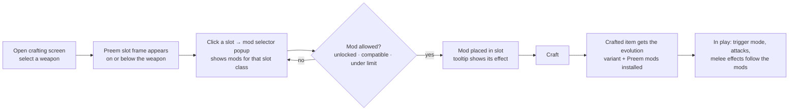

# Preem Weaponsmith — Spec

> **One line:** a Cyberpunk 2077 PC mod that lets players craft weapons with their own choice of Preem mods (barrels, triggers, magazines, blades, handles) that change how a weapon fires and behaves, right in the vanilla crafting screen.
> **Sources merged:** `docs/MODDING-WORKFLOW.md` (2026-10-25), release history v1.0.0–v2.2.5, Nexus description (`docs/nexus-description.txt`)
> **Terms:** `GLOSSARY.md` · **Hard-to-reverse decisions:** `docs/adr/`

## Status
*Updated at each phase end.*

| § | Feature | Status | Phase |
|---|---|---|---|
| 2 | Crafting with Preem mods (2.2.5 behaviour) | On 2.5: compiles, loads, all TweakDB records verified (self-check 4136/0), rule tests pass; one fix (`CraftItem` falls back when a weapon has no evolution variant). Not yet crafted in a loaded game (no save) | 1 |
| 4 | Preem mod catalogue and effects | Built (2.2.5), tweaks in redscript; all 38 offered mods' records resolve on 2.5 | 1, 2 |
| 5 | Progression: unlock mode and mod limit | Built (2.2.5); RedTest covers slot rules, compatibility and unlock tiers on 2.5 | 1 |
| 6 | Fire-mode sounds | Full metadata override from patch 2.12; on 2.5 it would remove 32 and roll back 446 vanilla audio entries (release blocker, gate decision). Moving to Audioware (decided 2026-10-25) | 3 |
| 7 | Settings | Per-save store `PreemSettings` built (verified at the main menu; save/load not yet checked). Mod Settings optional: seeds new saves when installed, built-ins otherwise. Own settings panel not built (needs a save to test) | 1 |
| 8 | Dev surface: self-check, RedTest, boot check | Built: compile check (+ exec/module warning), boot check (dependency check, screenshot on failure, `-Run`/`-HoldSec`, `-Without`), self-check, 47 RedTest checks, crafting and settings debug commands (crafting part needs a loaded save), Markdown pre-commit hook, `tools/pack-release.ps1` | 0, 1 |

## 1. Overview
- **Problem / pitch:** vanilla weapons come with fixed fire modes and evolutions (Power/Tech/Smart), and weapon mods are flat stat sticks. Preem Weaponsmith lets the player pick mods while crafting that change the weapon itself: switch evolution with a barrel, change the trigger mode, add elemental magazines, give melee weapons elemental blades or movement handles.
- **Users:** PC players on Nexus who craft weapons; mod users who also run EnhancedCraft.
- **Pillars:**
  1. **Feels native.** UI lives inside the vanilla crafting screen and matches its style.
  2. **Mods change behaviour, not just numbers.** A Tech barrel makes a Tech weapon; a burst trigger fires bursts.
  3. **Plays well with others.** Wrap game methods, never replace them; keep EnhancedCraft compatible.
  4. **Survives patches.** Hooks are few and listed, records are checked automatically, and the upgrade path is written down.
- **Non-goals:** console or mod.io builds (scripts aren't allowed there); new weapons, meshes or models; a CET or RED4ext rewrite; keeping saves from before patch 2.5 working, or making the 2.5 version backward compatible with earlier mod versions (decided 2026-10-25). Players are told a new save may be needed.

## 2. Core loop

Ranged weapons have Barrel, Trigger and Magazine slot classes (two slots each). Melee weapons have Blade and Handle. Sight is defined but not exposed.

## 3. Tech stack

| Part | Runs on / hosted by | Built with | Talks to |
|---|---|---|---|
| Mod scripts | Cyberpunk 2077 (PC), loaded by redscript | redscript; Codeware UI library | Game script classes through hooks; TweakDB at load time |
| Tweak data | TweakDB, at game load | `ScriptableTweak` (TweakXL scripting API); planned: TweakXL YAML | Vanilla weapon and item records it clones |
| Fire-mode sounds | Audioware (RED4ext plugin) | Audioware sound definitions; replaces the WolvenKit-built `.archive` | Game sound events for weapons |
| Settings | Own panel in the crafting screen, saved per save; optional Mod Settings page | redscript `ScriptableSystem` + Codeware popup; Mod Settings `@runtimeProperty` (optional) | Mod scripts read values |
| Dev surface (planned) | Game, dev installs only | redscript `PreemDev` module, RedTest, CET console | Mod classes; game logs |
| Distribution | Nexus Mods | red-cli `pack` zip | — |

Framework requirements: RED4ext, redscript, Codeware, TweakXL, and Audioware (from Phase 3). Optional: Mod Settings (sets defaults for new saves), EnhancedCraft.

## 4. Preem mod catalogue
Each **Preem mod** has a mod style (e.g. `Barrel_Tech`, `Trigger_InstaBurst`, `Mag_Thermal`, `Blade_Shock`), a slot class, optional required evolution, incompatible styles and a description. Each also has a TweakDB item record (`Items.Preem…`) holding its stat modifiers, which is what actually gets installed on the weapon.

| Slot class | Examples | Mechanism |
|---|---|---|
| Barrel | Tech, Smart, Power (evolution change), Silencer, Turbo, Extra Barrel, Velocity Booster | Evolution barrels swap the crafted item to an **evolution variant** record; others add stat modifiers |
| Trigger | Full Auto, Semi Auto, Burst, InstaBurst, Ultra Action, Charge | `WeaponObject` / `WeaponTransition` hooks pick the trigger mode and attack record |
| Magazine | Thermal, Electric, Chemical, Bleed, Extended, Quick | Stat modifiers and status-effect attacks |
| Blade (melee) | Chem, Shock, Thermal, Bleed, crit, Deflector | Melee attack hooks plus stat modifiers |
| Handle (melee) | Rubberized Grip, Attack Speed, Stamina Reduction, Dash/Leap | Melee hooks plus stat modifiers |

Evolution variants: at load, every ranged weapon record is cloned twice (for example a Power gun gets `_PreemTech` and `_PreemSmart` copies). Each copy gets that evolution's crosshair, effects and stat pools. Every weapon also gets the Preem attachment slots.

**Out of scope:** new visual attachments or meshes.
**Testing:** the self-check confirms that every mod record, slot and evolution variant exists and that their base records resolve on the current patch. RedTest covers `PreemModMaker.GetModFromModStyleType` definitions.

## 5. Progression
| Setting | Options | Effect |
|---|---|---|
| Mod Unlock System | Sandbox · Weapon Blueprints (default) | Sandbox: all mods available. Blueprints: mods unlock by the crafted weapon's rarity tier (Common → Legendary++) |
| Mod Limit System | Sandbox (default) · Weapon Blueprints | Limit on how many Preem mods one weapon can take |
| Slot layout | On Weapon · Below Weapon | Where the slot frame sits on the crafting screen |

Rules: a mod can be installed in a slot only if it is unlocked, its slot class matches, it isn't incompatible with already-slotted styles, and its required evolution (if any) is met.

**Testing:** RedTest on `PreemModSlotManager.CanInstallPreemModInSlot` and the `PreemModUnlocker` tier lists, with expected values taken from 2.2.5 behaviour.

## 6. Fire-mode sounds
Trigger mods that change fire mode need auto-fire sound events (`*_fire_auto`, `*_fire_auto_stop`, and suppressed variants) on weapons that never had them. Today the mod ships a modified copy of the game's whole `cooked_metadata.audio_metadata` to add them. That copy must be rebuilt every patch and conflicts with other audio mods.

**Decided (2026-10-25): use Audioware.** Audioware can add new sound events, not just replace existing ones (confirmed by the user 2026-10-25), so the needed events are added through it and the full metadata override is dropped.

| Need | Today | With Audioware |
|---|---|---|
| Auto-fire loop on weapons that were semi-auto | Added to the copied metadata | Audioware adds the event |
| Suppressed shots (silencer) | Only on weapons that had them | Can be supplied for any weapon (see the silencer idea) |
| Vanilla sounds | Frozen at the patch the copy was made from | Untouched |

**Out of scope:** new recorded audio; reuse the game's existing weapon sounds.
**Testing:** boot check shows Audioware loaded with no errors for Preem definitions; 🧑 gate listens to each fire-mode change.

## 7. Settings
**Decided (2026-10-25):** the mod must never depend on Mod Settings to work.

| Where | Role |
|---|---|
| Settings panel (button on the Preem slot frame, Codeware popup) | Main way to change the settings in §5 |
| Save file (per playthrough) | Where the values live. Each save keeps its own unlock mode, limit mode and layout |
| Mod Settings page (only if installed) | Sets the defaults that a **new** save starts with. Never required |
| Built-in defaults | Unlock = Weapon Blueprints, limit = Sandbox, layout = as in 2.2.5. Used when nothing else applies |

**Testing:** boot and craft with and without Mod Settings installed; change a setting in the panel, save, reload, and confirm it stuck; RedTest on the settings store.

## 8. Dev surface
A dev-only `PreemDev` redscript module (not shipped):
- `exec` functions callable from the CET console: ping, craft a test weapon with chosen mods, equip it, dump its Preem state, show and set the per-save settings.
- a self-check of every Preem record (one line per failed check and a count per kind of check, in CET's game log);
- a RedTest suite for the pure rules.

A boot-check script launches the game, waits for the main menu, collects the logs and closes the game. Together these let Claude verify a change without the human, up to the gates.

## Open questions
- Do persistent fields on a redscript `ScriptableSystem` save and load reliably on 2.5 for the settings store? Affects §7; checked in the Phase 1 settings-store task.
- Does `ScriptableSystem` attach at the main menu, or does the self-check need a loaded save? Affects §8; decided in Phase 0.
- Dual-wielding in 2.5: do trigger and melee hooks behave per weapon or per player when two weapons are held? Affects §2; Phase 1 hook review.
